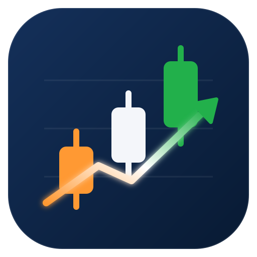
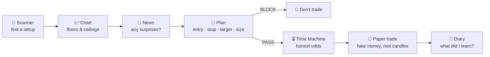

<div align="center">



# Dalal Street Skill

### Learn the Indian stock market with Claude, one trade at a time, with fake money first.

**सीखो पहले, कमाओ बाद में** · *Learn first, earn later*


</div>

> [!IMPORTANT]
> **For learning and practice only.** This project is **not** a SEBI-registered Investment Adviser or
> Research Analyst, not a stockbroker, and is **not affiliated with SEBI, RBI, NSE, BSE** or any broker.
> Nothing here is a tip, a recommendation or financial advice. It **never places real orders**.
> Read the full [DISCLAIMER](DISCLAIMER.md) before you use it.

---

## What is this?

**Dalal Street Skill** is a free pack of six [Claude](https://claude.ai) skills that teach you to read,
plan and practise trades on **Indian stocks listed on the NSE and BSE**, in India time (9:15 AM to
3:30 PM IST), in rupees, with Indian broker charges.

It's built for **complete beginners**. Claude explains every result like a patient teacher, defines each
trading word the first time it appears, and makes you **write the plan before the trade**. You practise
with **paper (fake) money** against **real market candles**, so you can learn without risking a rupee.

- ✅ Works on **NSE** (default) and **BSE** stocks, plus the Nifty 50, Bank Nifty and Sensex indices
- ✅ Free public data: no signup, no API key, no paid feed
- ✅ Plain standard-library Python: nothing to `pip install`
- ✅ Your broker stays yours: Groww, Zerodha, Upstox, Angel One... you place real orders yourself, by hand
- ❌ No buy/sell tips, no auto-trading, no F&O, no margin, no short selling

## The six skills

| Command | Job | What it does |
| --- | --- | --- |
| 🔎 `/nse-scanner` | **Market scanner** | Scans the Nifty 50 / 100 / 500 or your watchlist for opening-range breakouts, gap ups and gap downs, 20-day highs, oversold stocks and volume spikes |
| 📈 `/nse-chart` | **Chart reader** | Explains one stock's chart in plain words: the gap, the 9:15–9:30 opening range, VWAP, volume, **floors (support) and ceilings (resistance)** with how many times price turned there, and the last candles one by one |
| 📰 `/nse-news` | **News check** | Recent headlines in India time, tagged: results, dividend/bonus/split, orders, deals, SEBI/RBI, ratings, block deals |
| 📝 `/nse-plan` | **Trade planner + risk check** | Entry, stop-loss, target, **share count from the 1% risk rule**, estimated **brokerage, STT, stamp duty, GST**, and a **PASS / WARN / BLOCK** check against your rules |
| ⏳ `/nse-timemachine` | **Time Machine** | Replays the rest of the day **10,000 times** from the stock's own last 60 days of candles, re-runs the rule on every real past day, and gives you the honest odds |
| 🧾 `/nse-paper` | **Paper trader** | Fake-money trades checked candle by candle against real prices (stop, target, gaps, 3:20 PM exit), with a scorecard of wins, losses and average R |

You don't need to remember the commands. Just talk to Claude:

> *"Read Reliance's chart." · "Which Nifty stocks broke out this morning?" · "Plan a trade on Titan with
> a stop at the opening-range middle and a 2:1 target." · "What are the odds?" · "Paper trade it." ·
> "Did my paper trade hit the stop?"*

## How one trade flows



## See it in action

All the output below is **real**, from the NSE session of **29 October 2026**. These are examples of the
tool's output, not recommendations.

<details open>
<summary><b>🔎 Scanner: opening-range breakouts in the Nifty 50 by 10:15 AM</b></summary>

```text
$ python3 nse-scanner/scan.py orb --at 10:15
Opening-range scan, 50 stocks, 15-minute box (9:15 to 09:30), candles up to 10:15
26 broke out UP, 11 broke DOWN, 13 still inside the box.

BREAKOUTS (first close above the box), busiest first:
  stock        time      box top      close   beyond     vol     box  now
  TITAN        09:35     4381.10    4390.30    0.21%    2.7x   0.89%  holding 4401.50
  ADANIENT     09:35     2505.20    2505.70    0.02%    1.8x   1.23%  holding 2544.00
  EICHERMOT    09:55     7290.50    7294.00    0.05%    1.5x   0.93%  fell back 7262.50
```
</details>

<details>
<summary><b>📈 Chart reader: Jio Platforms (JPL) on its second day of trading</b></summary>

```text
$ python3 nse-chart/chart.py JPL
JPL.NS  Jio Platforms Limited  (2026-10-29, candles up to 15:30)

Price ₹1,421.60  UP ₹4.10 (+0.29%) from yesterday's close ₹1,417.50
Gap: it opened UP at ₹1,444, +1.87% above yesterday's close.
Opening range (9:15 to 09:30): ₹1,444 to ₹1,489.60. Price is BELOW the box.
VWAP (the day's average price, weighted by volume): ₹1,436.65. Price is below it, so sellers are in control today.

CEILINGS above (where sellers turned it down before):
   ₹1,427.45   2 touches, +0.41% away
   ₹1,424.42   6 touches, +0.20% away
-- price now ₹1,421.60 --
   ₹1,418.97   4 touches, -0.19% away
   ₹1,413.60   1 touch, -0.56% away
FLOORS below (where buyers held it up before)
```
</details>

<details>
<summary><b>📝 Planner: sizing a breakout trade with the 1% rule and Indian charges</b></summary>

```text
$ python3 nse-plan/plan.py TITAN --entry 4390.30 --stop or-mid --target 2R --setup orb
TRADE PLAN  TITAN (Titan Company Limited)  (intraday, paper, NSE)

  Buy        22 shares at ₹4,390.30   = ₹96,586.60
  Stop-loss  ₹4,361.85   (₹28.45 a share below)
  Target     ₹4,447.20   (₹56.90 a share above)
  Reward:risk 2.00 : 1   (after charges 1.66 : 1)

  If the stop hits:   -₹706.96   (-₹625.90 price + ₹81.06 charges)
  If the target hits: +₹1,170.21   (+₹1,251.80 price - ₹81.59 charges)
  Account ₹1,00,000, risk 1.0% = ₹1,000 max loss
  Close by 15:20 if neither the stop nor the target hits.

  PASS  Loss at the stop ₹625.90 (plus charges) is within your 1.0% limit ₹1,000.
  PASS  Reward:risk is 2.00:1 (minimum 2.0:1).
  PASS  Inside your entry window 09:30 to 14:30.

VERDICT: PASS. The plan follows your rules.
```
</details>

<details>
<summary><b>⏳ Time Machine: 10,000 replays and 59 real days of history</b></summary>

```text
$ python3 nse-timemachine/timemachine.py run
TIME MACHINE  TITAN  entry ₹4,390.30 at 10:15, stop ₹4,361.85, target ₹4,447.20 (2.00R)
Pool: 59 full sessions before 2026-10-29 (2026-08-04 to 2026-10-28). Seed 19.

10,000 replays of the rest of the day, 10:15 to 15:20 (61 five-minute candles):
  target first    11.5 %
  stop first      50.0 %
  neither         38.6 %   still open at 15:20
  green           40.5 %   target first, or above the entry at 15:20
  Average R: -0.063

History: the opening-range breakout rule on each of those 59 real days fired 35 times: 9 target, 18 stop, 8 neither. Average R +0.128.
Leans toward the stop: of the replays that hit a side, the target came first 18.7% of the time; a 2.0R target needs 33.3% to break even.
```

And the twist: on the real day, this Titan paper trade **hit its target at 14:30**. The odds said
"leans toward the stop", and it won anyway. **One trade proves nothing.** Only a long record of planned
trades tells you whether a method works. That's what the paper trader is for.
</details>

<details>
<summary><b>🧾 Paper trader: fake money, real candles</b></summary>

```text
$ python3 nse-paper/paper.py check
CLOSED #1 JPL.NS: stop-loss 66 at ₹1,410 (12:30). Gross -₹990, charges ₹80.07, net -₹1,070.07 (-1.00R).

$ python3 nse-paper/paper.py log
| # | date | stock | entry → exit | qty | how | net | R |
|---|---|---|---|---|---|---|---|
| 1 | 2026-10-29 | JPL | ₹1,425 → ₹1,410 | 66 | stop-loss | -₹1,070.07 | -1.00 |
| 2 | 2026-10-29 | TITAN | ₹4,390.30 → ₹4,447.20 | 22 | target | +₹1,170.21 | +2.00 |

2 trades: 1 win(s), 1 loss(es) (50% wins). Net +₹100.14. Average R +0.50.
Fewer than 20 trades: too few to judge a method yet. Keep logging.
```
</details>

## Install

You need [Claude Code](https://claude.com/claude-code) (terminal, desktop app or IDE) and Python 3.8+
(already on macOS and most Linux; on Windows install it from python.org).

**Option 1: as a plugin (easiest)**

```text
/plugin marketplace add anuraggautamsharma/dalal-street-skill
/plugin install dalal-street-skill@dalal-street-skill
```

Plugin skills are namespaced, so the commands appear as `/dalal-street-skill:nse-chart` and so on. You
can also just ask in plain words.

**Option 2: copy the skills (short `/nse-chart` commands)**

```bash
git clone https://github.com/anuraggautamsharma/dalal-street-skill.git
mkdir -p ~/.claude/skills
cp -r dalal-street-skill/nse-* ~/.claude/skills/
```

Copy them into a project's `.claude/skills/` instead if you want them in one folder only. Keep `nse-lib`
next to the other `nse-*` folders: every skill uses it.

**Option 3: just ask Claude.** Paste this into Claude Code:

```text
https://github.com/anuraggautamsharma/dalal-street-skill
install this skill
```

Start a new Claude Code session after installing so the skills load. Your data (rules, plans, paper
account) goes into a `trader-data/` folder in whatever folder you run Claude from.

## Quick start: your first paper trade

```text
1. "Set up a paper account with ₹1,00,000."            → /nse-paper init
2. (after 9:30 AM) "Scan the Nifty 50 for breakouts."   → /nse-scanner orb
3. "Read TITAN's chart."                                → /nse-chart
4. "Plan it: stop at the box middle, target 2R."        → /nse-plan --write
5. "Run the time machine."                              → /nse-timemachine
6. "Paper trade it."                                    → /nse-paper open
7. "Check it." (or "/loop 5m check my paper trade")     → /nse-paper check
```

New to all of this? Start with the **[Beginner's Guide](docs/BEGINNERS-GUIDE.md)**. It explains every
word (candle, bid/ask, stop-loss, VWAP, R...) the way you'd explain it to a 12-year-old.

## Your rules

The planner checks every trade against `trader-data/config.json` (copy
[`config.example.json`](config.example.json); the defaults below apply if there's no file):

| Rule | Default | Why |
| --- | --- | --- |
| `account` | ₹1,00,000 | Paper money to practise with |
| `risk_pct` | 1% | The most one trade may lose (₹1,000 on ₹1,00,000) |
| `min_reward_risk` | 2 | The target must be at least 2× the risk |
| `max_trades_per_day` | 3 | Fewer, better trades |
| `daily_loss_limit_pct` | 2% | After losing this much, stop for the day |
| `entry_window` | 09:30–14:30 | Skip the wild first 15 minutes; late entries have no time to work |
| `flat_by` | 15:20 | Intraday trades are closed before the 3:30 PM close |
| `kind` | intraday | `intraday` or `delivery` (changes STT, stamp duty, DP charges) |
| `exchange` | NSE | `NSE` or `BSE` |

Any **BLOCK** means "don't take this trade", not even on paper.

## Indian charges, built in

Every plan and paper trade includes estimated charges for one buy and one sell:

| Charge | Intraday | Delivery |
| --- | --- | --- |
| Brokerage (default: ₹20 or 0.1% per order, whichever is lower, min ₹5) | ✅ | ✅ |
| STT (Securities Transaction Tax) | 0.025% on the sell | 0.1% on buy and sell |
| Exchange transaction charge | NSE 0.00297% / BSE 0.00375% | same |
| SEBI turnover fee | ₹10 per crore | same |
| Stamp duty | 0.003% on the buy | 0.015% on the buy |
| GST | 18% on brokerage + exchange + SEBI fee | same |
| DP charge | none | ₹13.50 + GST per stock sold, per day |

The defaults follow Groww's published equity rates. **Charges change, and every broker is different**:
check your broker's pricing page and override any rate under `"charges"` in your config. Example: a
broker charging 0.03% capped at ₹20 with no minimum:

```json
{ "charges": { "brokerage_pct": 0.0003, "brokerage_max": 20, "brokerage_min": 0 } }
```

## Symbols and market hours

| You type | Means |
| --- | --- |
| `RELIANCE`, `TCS`, `HDFCBANK`, `JPL` | NSE symbol, as broker apps show it |
| `RELIANCE --exchange BSE` or `RELIANCE.BO` | the BSE listing |
| `JIO` | Jio Platforms (`JPL`) |
| `NIFTY`, `BANKNIFTY`, `SENSEX` | the indices (for reading charts) |
| `nifty50`, `nifty100`, `nifty500` | NSE's official index lists, for the scanner |

| Time (IST, Mon–Fri) | Market | What to run |
| --- | --- | --- |
| before 9:00 | closed | `/nse-scanner daily`, `/nse-news` |
| 9:00–9:15 | pre-open | nothing yet |
| 9:15–9:30 | open: the opening range forms | watch, don't trade |
| 9:30–14:30 | open | scanner, chart, plan, time machine, paper |
| 14:30–15:30 | open | manage open paper trades; out by 15:20 |
| after 15:30 | closed | `/nse-paper log`, write your diary, `/nse-scanner daily` |

## What it will never do

- 🚫 Place a real order, connect to your broker, or touch your money
- 🚫 Ask for passwords, PINs, OTPs or API keys
- 🚫 Tell you to buy, sell or hold anything
- 🚫 Promise profits or call a simulation a prediction
- 🚫 Trade F&O, use margin (MTF) or short sell

## Honest limits

- **Data:** free, unofficial Yahoo Finance data in 5-minute candles. It can lag, have small gaps, and
  differ slightly from your broker. Always check your broker app before acting.
- **New listings:** the Time Machine needs at least 20 past trading days, so it refuses fresh IPOs.
- **Holidays:** the tools don't know the NSE holiday list. A weekday with no candles is a holiday.
- **Stops aren't guarantees:** in a fast fall or a gap, a real stop-loss can fill worse than its price.
  The paper trader models gap slippage, but real markets can be worse.
- **Paper isn't real:** real money brings fear and greed that paper doesn't. Expect real results to be
  worse than paper results.

## FAQ

**Is this a tips or signals service?** No. It finds setups, does the arithmetic on *your* plan, and
simulates outcomes. You decide everything, and you place real orders yourself.

**Can it trade automatically?** No, by design. Nothing in this pack can place an order.

**Which brokers does it work with?** Any. It never connects to a broker. It uses public market data and
lets you set your broker's charges.

**Does it work for F&O?** No. SEBI's own studies found that about 9 in 10 individual F&O traders lost money.
Learn the cash market first.

**Is it free?** Yes, MIT-licensed. You need a Claude plan that includes Claude Code.

## For developers

```bash
python3 tests/test_india_trader.py     # offline tests: charges, levels, Time Machine logic
```

```text
nse-lib/           shared engine: Yahoo candles, IST clock, NSE lists, charges, safety rules
nse-chart/         SKILL.md + chart.py
nse-scanner/       SKILL.md + scan.py
nse-news/          SKILL.md + news.py
nse-plan/          SKILL.md + plan.py
nse-timemachine/   SKILL.md + timemachine.py
nse-paper/         SKILL.md + paper.py
tests/             offline unittest suite
docs/              beginner's guide
```

Contributions are welcome: NSE holiday calendar, more setups, better charge presets for other brokers,
Hindi explanations. Please keep the safety rules: no order placement, no tips.

## Credits

The Time Machine method and the scan → plan → check → paper flow were inspired by the US-market
[Day Trader skill](https://github.com/Jakeschincariol/day-trader-skill) by Jake Schincariol (MIT).
Dalal Street Skill is a fresh implementation for Indian markets: IST sessions, NSE/BSE symbols, Indian
charges and broker-free paper trading.

## ⚠️ Disclaimer

This software is for **education and paper-trading practice only**. The authors and contributors are
**not registered with SEBI** as Investment Advisers, Research Analysts or stockbrokers, and this project
is **not affiliated with, endorsed by or connected to SEBI, RBI, NSE, BSE, NSDL, CDSL, any broker
(including Groww), Yahoo or Anthropic**. Nothing here is investment advice, a recommendation, or an
offer to buy or sell securities. Trading in securities is subject to market risks, and **you can lose
money**. Do your own research and consult a SEBI-registered investment adviser before investing. Full
text: [DISCLAIMER.md](DISCLAIMER.md).

<div align="center">

Made with ❤️ for every new trader in India · MIT License

</div>
